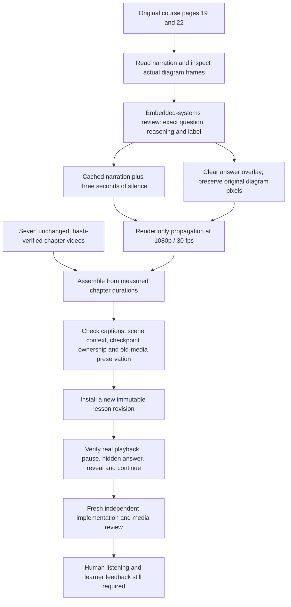

# Receiving-endpoint checkpoint

This bounded revision closes the propagation chapter's spoken-pause gap. Its content review covers that chapter and one recall/explanation question. It does not approve the separate 100-objective teaching draft or establish whole-lesson teaching quality.

## Evidence and production flow

These arrows describe the verification workflow. A stage's checks establish only their stated scope; schema validity or successful rendering cannot establish learning efficacy.

## Reviewed question

**Question:** For this synchronous read, where must the returned data meet the setup requirement, and why is the slave's internal Data Valid signal alone insufficient?

**Explanation:** At the receiving master (M), at least the required setup time before the next positive clock edge. The slave's internal Data Valid signal precedes the driver and bus propagation delays, so it does not establish that data is already stable at M.

**On-frame label:** PAUSE · Where must returned data meet setup?

The reviewer checked all 18 narration cues, complete original PDF pages 19/22, the stored diagram crops and actual preview frames. Page 19 supports the outward address path; page 22 supports the returned-data path and setup at M. Internal Data Valid and data already stable at S are distinct stages. The latter has already passed the slave driver.

The chapter teaches the endpoint before asking this question. It is a recall/explanation check. The question frame must clear the answer overlay and show the full stored diagram crop, with source attribution. It does not show the complete PDF page. The existing spoken narration needs no scientific correction. Content-review evidence remains local in `artifacts/endpoint-content-review/decision.json`.

## Production and verification status

The updated [local lesson](http://127.0.0.1:5173/?course=8&revision=12) is course 8, lesson 3, revision ID 12, displayed as **Revision 5**. Use **Practice 3 · 7:31** to inspect the new checkpoint. Its video is 930.700001 seconds at 1920×1080 / 30 fps, with eight chapters, 100 scenes, 153 caption cues and seven checkpoints. The original revision 6 and the 720p authoring candidate remain unchanged.

Independent preservation checks compare the prior revisions, source bindings and video hashes against `artifacts/endpoint-production-before/`. All 10 earlier revisions, 14 sources, 226 pages, 11 regions, nine study items and 19 jobs match their baseline rows. Ten protected files retain their hashes, including all five earlier videos. The seven unaffected chapter videos were reused. The existing six checkpoint IDs, questions and explanations are preserved; later times shift by the measured 3.000001-second chapter delta. The new checkpoint is at global 451.117124 seconds, in scene `propagation-12`, bound to region `r6` on original page 22. All scene objects and source bindings remain unchanged.

The installed file was decoded completely; its hash is `70f70e8ca5c3b50771d52b3932f0d181cc17043f4f7a1ed2608275d49b82bd65`. Sidecar/embedded captions, HTTP range playback and unchanged spoken PCM outside the added silence pass. The unchanged second helper invocation reused audio, chapter render, assembly and installation, returning the same revision 12 / job 48. It created no further rows.

The final code has 24 passing authored-lesson tests, four passing frontend practice/timeline tests and four passing Django context/source tests. Frontend build and lint pass; the existing bundle-size warning remains. Independent review found two importer issues: cleanup needed proof of directory ownership, and cached installs needed exact spec/citation/plan/manifest checks. Both were fixed and covered by collision and metadata-tampering regressions. The first production attempt was interrupted before a database transaction; its completed chapter cache remains as evidence. The corrected program produced a new chapter cache identity. Only one new revision was installed.

Actual browser playback crossed the checkpoint from an earlier scene time and paused at 451.117124 seconds. It remained paused at that time for 17.248 seconds. The explanation was initially hidden; reveal, hide and Continue worked, and playback advanced to 461.677163 seconds. Selecting the original page-22 diagram attached the 7:31 moment to chat. No message was submitted, so this does not verify a provider answer or a focused follow-up. Browser console errors were empty. The saved-revision teaching validator still reports the intentionally absent teaching plan, but its propagation pause-gap diagnostic falls from one on revision 6 to zero on revision 12.

The fresh final reviewer **approved this bounded revision** after independently checking code, regression tests, installed media metadata and the question frame, and inspecting the root's browser records. The reviewer did not independently repeat browser interaction. The decision is recorded in `artifacts/endpoint-final-review/review.json`. Other evidence is local under `artifacts/endpoint-production/` (`verification.json`, `independent-check.json`, `browser-check.json` and screenshots) and `artifacts/endpoint-final-review/`.

The three-second quiet interval supports uninterrupted viewing mode. With practice pauses enabled, the player waits for learner action. Human listening, pronunciation/pacing feedback and learning outcomes remain unverified. No cloud generation, speech regeneration, paid fallback or publication occurred in this packet. This is a reviewed local demonstration path, not evidence of equivalence to 3Blue1Brown or a complete automatic teaching-plan compiler.
