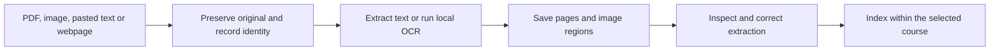
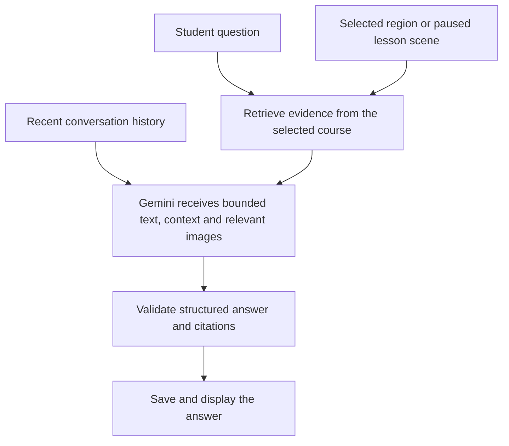
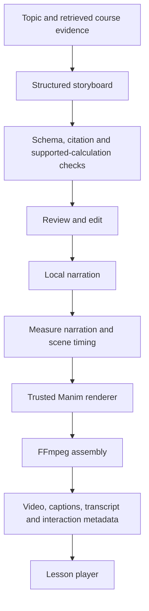
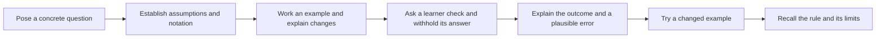

# TLDR — Complete Project Overview

**Implementation snapshot: October 14, 2026. UI direction selected: October 15, 2026.**

This document brings together the product idea, existing features, application architecture, memory system, source-to-lesson pipeline, student workflow, verification evidence, frontend directions, and remaining work.

TLDR is a local desktop-browser study workspace that connects course material, a tutor, visual lessons, and practice. The intended experience lets a student move between an original source and an explanation while retaining the page, diagram, region, or lesson moment being discussed.

The current project has a working local workspace and a reviewed, authored video demonstration. The complete automatic workflow—upload material and receive an excellent visual lesson—is still being built. Implemented infrastructure, successful local demonstrations, and unverified AI capabilities are distinguished throughout this document.

## Contents

1. [Product purpose and scope](#1-product-purpose-and-scope)
2. [The student workflow](#2-the-student-workflow)
3. [Main application areas](#3-main-application-areas)
4. [Architecture and tools](#4-architecture-and-tools)
5. [Source ingestion](#5-source-ingestion)
6. [Memory and retrieval](#6-memory-and-retrieval)
7. [Image-aware tutor chat](#7-image-aware-tutor-chat)
8. [Teaching plans and storyboards](#8-teaching-plans-and-storyboards)
9. [Visual lesson production](#9-visual-lesson-production)
10. [How a chapter should teach](#10-how-a-chapter-should-teach)
11. [Playback, questions, and follow-ups](#11-playback-questions-and-follow-ups)
12. [Study tools and learner progress](#12-study-tools-and-learner-progress)
13. [Jobs, recovery, caching, and revisions](#13-jobs-recovery-caching-and-revisions)
14. [Accuracy and source fidelity](#14-accuracy-and-source-fidelity)
15. [Current samples and verification](#15-current-samples-and-verification)
16. [Frontend design directions](#16-frontend-design-directions)
17. [Local storage, cloud use, and cost boundaries](#17-local-storage-cloud-use-and-cost-boundaries)
18. [Remaining implementation work](#18-remaining-implementation-work)
19. [Running the project and locating the code](#19-running-the-project-and-locating-the-code)
20. [Supporting records](#20-supporting-records)

## 1. Product purpose and scope

TLDR should help students understand visual and technical material rather than only summarize text. Its central use cases include reading a timing diagram, following a mathematical derivation, understanding a process, asking about a selected image region, and revisiting an explanation through practice.

The intended product includes:

- Course folders containing related sources, conversations, lessons, and study items.
- A source viewer that preserves original material alongside editable extracted text.
- Image-aware questions grounded in the selected course.
- Editable teaching plans and storyboards.
- Narrated visual lessons with captions, transcripts, and contextual questions.
- Flashcards, quizzes, checklists, bookmarks, and confusing moments.
- Local records that survive restarts.

The scope is Windows-first, English narration, typed questions, local files, and a desktop browser. Public accounts and a mobile application are outside the current scope.

Courses can contain material from different subjects. That does not establish that arbitrary physics, finance, biology, mathematics, or engineering visuals can be generated accurately. Technical visual support depends on the available bounded tools and review.

## 2. The student workflow

1. Create a course folder.
2. Add lecture PDFs, screenshots, pasted text, or a webpage.
3. Read the originals and inspect the extracted text.
4. Correct extraction errors and select relevant image regions.
5. Ask questions using the course evidence.
6. Choose a concept for a lesson.
7. Review the storyboard and write or revise its teaching plan.
8. Render the reviewed lesson.
9. Watch, pause, select visual context, and ask about a particular moment.
10. Save useful explanations or confusing moments as study items.
11. Return later for recall and application practice.

For example, a student could add ECE224 notes, select a bus timing diagram, ask about propagation delay, review a proposed explanation, and watch a lesson that stops at a receiving-endpoint question.

The local interfaces and production mechanisms cover parts of this sequence. Successful live AI answers and automatic lesson quality remain unverified.

## 3. Main application areas

| Area | Contents and responsibility |
| --- | --- |
| Courses | Separate collections of sources, conversations, lessons, and study items |
| Sources | Original files, page images, extracted text, corrections, selected regions, and webpage provenance |
| Tutor chat | Questions, retrieved evidence, relevant images, citations, and persisted conversation history |
| Lesson studio | Editable storyboards, separate teaching plans, immutable revisions, rendering controls, and playback |
| Study tools | Flashcards, quizzes, checklists, bookmarks, and confusing moments |
| Activity | Import, chat, storyboard, and render jobs, with status, cancellation, and retry |
| Export | A course archive containing records, original documents, and rendered material |

The current interface is a functional prototype. The ten new design images are concepts and have not replaced it.

## 4. Architecture and tools

| Component | Responsibility |
| --- | --- |
| React, TypeScript, Vite | Browser workspace, source selection, editing, playback, and study interactions |
| Django REST Framework | Local APIs, request validation, course boundaries, and job handling |
| SQLite | Persistent application records |
| SQLite FTS5 | Course-scoped full-text retrieval |
| Local media directory | Originals, page images, narration, videos, captions, and caches |
| Gemini adapter | Requests structured tutor answers and storyboards when generation is enabled |
| Optional Ollama / embeddinggemma | Local semantic retrieval; not verified in this installation |
| Tesseract | Local OCR for screenshots and scanned material |
| Manim Community | Local drawing and animation through trusted renderer code |
| Local speech synthesis | Narration generation |
| FFmpeg | Audio/video assembly and caption packaging |
| KaTeX | Browser math formatting |
| MathJax-to-SVG | Supported equation formatting for video |

The general speech path uses installed Windows voices. The authored showcase also uses cached narration generated locally with Kokoro.

Lane helps route development and independent review work while the project is being built. It is not a service inside the running tutor. Image generation produced the frontend concept mockups; the lesson renderer uses the separate source-preserving and controlled-animation paths described below.

## 5. Source ingestion



### PDFs and images

PDF ingestion retains the original file, page images, and extracted text. Screenshots and scanned pages use local OCR where available.

Original extraction and corrected text are stored separately. A correction updates the searchable text without replacing the original document.

The source viewer supports rectangular regions with normalized coordinates. These regions can have labels, text, and confirmation state. The viewer accounts for zoom and supported 90-degree page rotations when mapping selections.

OCR is not a diagram parser. Labels, equations, and reading order can be wrong, so extraction remains reviewable.

### Websites

Web importing handles one public HTTPS page per request. It saves the fetched HTML and records its origin, final URL, and fetch time. Extraction retains readable text, headings, links, available source TeX, and image alternative text.

It does not crawl the entire site, execute remote scripts, or archive the page's images and interactive diagrams. A PDF or uploaded image is the appropriate source when faithful visual preservation is needed.

Paul's Online Math Notes supplies a sample for this text-and-equation import path.

Uploaded documents and website contents are source material. Instructions inside them do not authorize code execution, workflow changes, or transmission of other files.

## 6. Memory and retrieval

TLDR uses three distinct kinds of memory.

| Memory | What it retains |
| --- | --- |
| Application records | Courses, sources, corrections, regions, conversations, messages, lessons, study items, and completion fields |
| Course retrieval | Relevant source passages and selected regions supplied to a particular request |
| Production caches | Narration and rendered work that can be reused |

### RAG

The project still uses retrieval-augmented generation, or RAG. It retrieves material from the selected course and supplies that material to the AI with the question or lesson request.

The current retrieval implementation:

- Searches extracted page text using SQLite FTS5.
- Includes explicitly selected regions.
- Adds the actual source references of a paused lesson scene.
- Supplies a bounded merged evidence set, currently up to eight items.
- Selects bounded text windows around relevant terms.
- Can optionally combine lexical retrieval with local embeddinggemma similarity results through Ollama.

The optional embedding path exists but has not been verified in this installation. Full-text retrieval works without it.

### Conversation memory

Messages persist in SQLite across restarts. A current chat request supplies the most recent ten completed messages, retrieved evidence, and any paused-scene context.

The model is not given unlimited access to every prior conversation. Automatic long-term conversation search, durable conversation summaries, and a sophisticated learner model are not implemented.

The app does not train a local tutoring model on uploaded notes.

## 7. Image-aware tutor chat



The application can supply relevant page images and selected crops with the text. The current generation path limits requests to three downsampled images.

The tutor request asks for structured output. The backend checks the answer shape and requires supporting citations. Quoted citations must occur exactly in the retrieved extraction. A separate visual-only mechanism supports selected regions without extracted text when their image was actually supplied.

These checks establish evidence identity and quotation integrity. They do not prove that an interpretation of a diagram is scientifically correct.

Answers are validated before delivery. The event-stream interface reports job progress and delivers the persisted answer; it does not expose unchecked model tokens as they are generated.

### Live status boundary

The adapter and job workflow exist. The last recorded live generation test paused after HTTP 503. Successful live answers, image interpretation, AI-generated storyboards, and generated follow-up lessons remain unverified end to end. This is a record of the last test, not a new claim about current provider availability.

## 8. Teaching plans and storyboards

These records have different purposes.

| Record | Main question it answers |
| --- | --- |
| Teaching plan | What should the learner understand, what prerequisites are needed, and how will understanding be checked? |
| Storyboard / renderer specification | What appears in each chapter and scene, what is spoken, and what visual actions are supported? |

### Teaching-plan fields

The separate planning format supports learning goals, assumed prerequisites, prerequisite links, scene assignments, evidence fingerprints, visual purposes, and proposed questions with expected reasoning.

The validator checks structural problems including:

- Broken or foreign-course source references.
- Stale evidence bindings after source changes.
- Missing scene, goal, or object references.
- Prerequisite cycles.
- Unsupported or mismatched visual requests.
- Goals without explanation or planned assessment coverage.
- Certain explicit spoken pause cues without an installed checkpoint in the scene.

Reports are recomputed. A valid report is not saved as a permanent approval badge. Incomplete drafts can be saved when they have no integrity errors.

Teaching plans are stored on new immutable revisions. Older and generated revisions can explicitly have no plan. The initial AI storyboard generation path does not automatically populate this richer planning layer.

### Planned questions versus installed checkpoints

A question in a teaching plan is a proposed assessment. It does not install a pause in a video, change the narration, or create an answer/reveal interaction.

A real checkpoint requires rendered media and authoritative timing metadata, followed by player verification.

The separate ECE224 draft currently has eight goals, 100 scene plans, and eleven planned questions. It has no rendered video and has not received independent teaching approval for all those annotations.

## 9. Visual lesson production

The following diagram describes implemented routes. The existence of a route does not establish successful live AI generation or teaching quality.



### Visual categories

| Category | Meaning |
| --- | --- |
| Original source image | Preserve the supplied diagram and add separate highlights, crops, or reading guides |
| Checked calculation | Draw output from a supported calculation with explicit inputs and assumptions |
| Conceptual illustration | Explain an idea while identifying the drawing as illustrative |

The original-source path addresses the concern about inaccurate recreated STEM diagrams. The course's actual figure can remain the teaching visual.

The AI supplies constrained lesson JSON. It cannot supply unrestricted Python for execution, install renderer extensions, select arbitrary filesystem paths, or load remote assets through the lesson specification. New visual capabilities require trusted project code and bounded inputs.

### Two production paths

The general renderer uses reusable supported primitives and validated lesson descriptions. Supported objects include equations, graphs, geometry, processes, circuit symbols, bus links, timing signals, and original source images, subject to the existing contracts.

The authored showcase uses custom reviewed choreography: persistent objects, sentence-directed source focus, token motion, and carefully staged changes. This richer behavior has not yet been fully exposed through an automatic teaching-plan compiler.

Circuit symbols and logical timing illustrations do not simulate arbitrary circuits or processor protocols. General 3D physics, unrestricted symbolic derivations, and arbitrary domain solvers are not implemented.

### Narration, equations, and outputs

Narration is generated locally and measured before final assembly. Lesson targets are 10, 15, or 20 minutes; actual duration is checked rather than padded with blank footage.

Browser math uses KaTeX. Supported video equations pass through bounded MathJax-to-SVG typesetting. Typesetting does not verify a formula or derivation.

The resulting media includes a video, captions, transcript, poster, and interaction manifest. The manifest connects actual times to chapters, scenes, objects, source references, and practice checkpoints.

## 10. How a chapter should teach

The intended teaching sequence is an editable design proposal, not a fully automated or scientifically validated recipe.



Animation should serve the reasoning. Keep a useful diagram visible, show what changes, and connect each change to the narration. Distinguish states such as an address being selected, data becoming available, and data being stored.

Some questions ask for a prediction before an outcome is shown; others check recall or explanation after teaching. Their purpose should be explicit.

A more complete scene contract should record the learning goal, prerequisites, claims, supporting evidence, assumptions, visual choice, before/action/after states, narration cues, learner check, review status, and dependencies. Parts of this exist in current plans and renderer records; a complete claim ledger and compiler remain planned.

## 11. Playback, questions, and follow-ups

The player uses the completed manifest's authoritative times. A paused question can retain this context:

```json
{
  "revision_id": 12,
  "scene_id": "propagation-12",
  "time_seconds": 451.117124,
  "object_ids": ["diagram-22"]
}
```

The backend resolves the scene's source references within the course. Even a question such as "Why?" can therefore carry the relevant scene and evidence.

Source-region selection happens in the source viewer. During playback, users select named visual objects. Automatic semantic hit-testing of every animated pixel is not implemented.

Practice checkpoints can pause playback, keep explanations hidden, reveal or hide them, and continue on learner action. A short quiet interval in the movie is separate from the player's indefinite wait at an enabled checkpoint.

A focused follow-up is designed as a separate one-to-three-minute lesson, preserving the original revision. Its application path exists, but successful live AI generation remains unverified.

## 12. Study tools and learner progress

Study items include flashcards, quizzes, checklists, bookmarks, and confusing moments. They can be associated with a course, source page, or lesson.

Raw LaTeX is retained while editing. Browser previews format math in chat, notes, source text, quiz choices, and both sides of flashcards.

The records support basic answers, attempts where provided, and completion fields. They do not establish a verified adaptive assessment system, automatic misconception diagnosis, or a reliable model of mastery.

Watching a lesson or revealing an answer does not prove understanding. A fuller study loop should record learner responses, use reviewed answer rubrics, offer targeted practice, and evaluate later recall and application.

## 13. Jobs, recovery, caching, and revisions

Imports, tutor questions, storyboard generation, and rendering use persistent jobs.

| Job state | Meaning |
| --- | --- |
| Queued | Waiting for an available worker lane |
| Running | Claimed by the worker |
| Complete | Finished and saved |
| Failed | Stopped with a recorded error |
| Cancelled | Explicitly cancelled |
| Paused | Work retained while generation is unavailable or a limit requires intervention |

The worker has one generation/ingestion lane and one rendering lane. It supports bounded retries, cancellation, and recovery of interrupted running jobs at startup.

Completed scene and narration work can be reused. The authored chapter path also includes source, audio, and program identities in cache keys. An unchanged rerun should reuse completed work rather than repeatedly generate it.

Lesson edits create new revisions. Old specifications and media remain intact. Source-image identity and region geometry are bound to revisions so a changed source cannot silently substitute different pixels into an older lesson.

General dependency tracking from every claim and prerequisite through every review decision is still planned. Existing media caching does not provide that complete teaching-dependency system.

## 14. Accuracy and source fidelity

Accuracy requires several distinct checks.

| Layer | Existing evidence or mechanism | Its limit |
| --- | --- | --- |
| Course isolation | References and retrieval are scoped to the selected course | Does not establish the truth of a source |
| Original-image identity | Source hashes and revision-bound crops preserve image identity | Does not interpret the image |
| Citation validation | Exact quotations are checked against retrieved extraction | A matching quote may not support the conclusion |
| Structural validation | Closed schemas and reference checks reject malformed or unsupported records | A well-shaped explanation can still be wrong |
| Supported calculations | Bounded known-answer checks validate specific calculations | Does not prove arbitrary scientific claims |
| Content review | A reviewer can inspect original evidence and reasoning | Approval covers the reviewed scope only |
| Media and interaction checks | Decoded frames, captions, timing, and player behavior can be inspected | Does not establish pronunciation, pacing, or learning efficacy |
| Human evaluation | Listening and learner feedback are required | Not completed for the full current lesson |

The proposed production pipeline adds persistent claim-support decisions, conflict handling, and enforceable accuracy/release gates. The current teaching-plan validator does not implement all those gates.

Uncertain extraction, unsupported visuals, and conflicting evidence should lead to correction or an explicit limitation. A second fluent AI answer is not independent proof.

## 15. Current samples and verification

### ECE224 playback demonstration

Open the local lesson at:

<http://127.0.0.1:5173/?course=8&revision=12>

It is course 8, lesson 3, revision ID 12, displayed as Revision 5.

| Property | Recorded result |
| --- | --- |
| Duration | 930.700001 seconds, approximately 15½ minutes |
| Resolution and frame rate | 1920×1080, 30 fps |
| Chapters | 8 |
| Scenes | 100 |
| Caption cues | 153 |
| Practice checkpoints | 7 |
| Latest added checkpoint | Practice 3, approximately 7:31 |

The receiving-endpoint checkpoint uses original page-22 diagram material. Content review tightened the wording to distinguish the slave's internal Data Valid signal from data already stable at the slave pins. The chapter teaches the endpoint first, so this is a recall/explanation check.

Actual playback automatically paused at 451.117124 seconds and remained paused for more than 17 seconds. The explanation began hidden; reveal, hide, and Continue worked. Selecting the original diagram attached the moment in the chat UI. No AI message was submitted in that test.

The new revision received bounded content and implementation review. The final reviewer independently inspected code, focused tests, installed media metadata, and an actual question frame. Browser conclusions relied on inspected coordinator records and screenshots rather than a second independent browser run.

The video was decoded completely. Earlier revisions, source records, study items, jobs, and protected video files were preserved. Seven unaffected chapters were reused. The unchanged second production invocation reused audio, chapter render, assembly, and installation, returning the same revision 12 and job 48.

The bounded checkpoint packet passed 24 authored-lesson tests, four frontend practice/timeline tests, four Django context/source tests, frontend build, and lint. The earlier teaching-plan foundation passed the full 98-test backend and 29-test frontend suites at that stage. These are different verification scopes, not one combined current full-suite run.

Human listening, pronunciation/pacing feedback, learning outcomes, and equivalence to 3Blue1Brown's quality remain unverified.

### Separate teaching draft

The ECE224 planning draft is revision ID 11 in a separate lesson. It contains eight goals, 100 scene plans, and eleven planned questions. It has no rendered video or installed checkpoints. Its structural report does not constitute independent teaching approval.

### Other samples

- Calculus website material demonstrates single-page import from Paul's Online Math Notes.
- The mathematics sample includes formatted notes, two flashcards, a quiz, and a short narrated equation video.
- An original-only planning workspace demonstrates teaching-plan forms and validation.
- The static portfolio preview uses original sample material and makes no AI requests.

## 16. Frontend design directions

### Selected direction: Cinema + Margin

On October 15, 2026, the user selected a combination of **02 Cinema for Video mode** and **03 Margin for Notes/Text mode**, using the two attached reference images. This is the current frontend direction. Implementation and usability acceptance remain pending.

| Mode | Layout and appearance | Main task |
| --- | --- | --- |
| Video | Charcoal teaching surface, restrained amber accent, dominant video canvas, chapters below, contextual tutor on the right, expandable transcript | Watch an explanation and ask about a particular moment |
| Notes/Text | Light academic reading surface, navy text and accents, course/section outline on the left, readable central text and equations, Sources/Tutor/Flashcards tabs on the right | Read, annotate, and study written material |

Both modes belong to one application and use shared course navigation, content identity, control styles, citation behavior, and keyboard conventions. A visible **Video / Notes** switch should make the relationship clear. The header should retain the course and current topic; the larger course browser can collapse when watching a lesson.

Video mode should prioritize the existing real player and its working checkpoint behavior. Chapter navigation must use the actual manifest. The right-hand tutor should make the attached timestamp and selected object clear. Practice questions must remain readable without covering important instructional content. The transcript can expand when needed.

Notes/Text mode should prioritize readable paragraphs, LaTeX, original figures, and citations. Provide an explicit way to view the original PDF/image alongside the text when needed. Keep personal notes distinct from corrections to extracted source text, and label lesson transcripts, authored explanations, and source extraction according to what they are. The reference's fictional textbook content must not become application content.

Switching modes should preserve the current course and topic, retain the video position, and preserve the reading position when returning to notes. If a scene has an explicit source binding, offer a direct link to that page or region. Do not invent a paragraph-to-timestamp mapping when none exists. Keep the tutor's attached context visible and accurate when the mode changes; changing course must not carry another course's context into a request.

Shared acceptance requirements:

- Use actual course material, source identities, and existing lesson media rather than mockup text or invented citations.
- Preserve original diagram pixels, annotation alignment, and revision-bound source references.
- Keep inline/display math and flashcard math readable in both visual environments.
- Support a collapsible tutor and reading/navigation panels without losing the active content.
- Preserve keyboard access, visible focus, contrast, readable small labels, and contained equation overflow.
- Check switching modes, asking with context, citations, practice reveal/continue, and source-region selection using real ECE224 and calculus samples.
- Keep provider failures and paused generation visible without making the study surface a configuration dashboard.

Persistent reference images: [02 Cinema](../output/imagegen/tldr-ui-round-2/02-cinema.png) and [03 Margin](../output/imagegen/tldr-ui-round-2/03-margin.png).

### Other explored directions

Ten image mockups were generated for comparison. They remain useful references; the selected two-mode combination above supersedes an open-ended choice among all ten.

| Number | Direction | Main idea |
| --- | --- | --- |
| 01 | Studio | Balanced course navigation, dominant visual lesson, and adjacent tutor |
| 02 | Cinema | Large dark lesson theater with chapters and contextual questions |
| 03 | Margin | Academic reader with annotations and source notes in the margin |
| 04 | Library | Course folders, continued learning, and a study checklist |
| 05 | Evidence | Dominant PDF viewer, selected regions, and cited discussion |
| 06 | Seminar | Calm chat-first tutoring with attached material and next steps |
| 07 | Workbench | Technical canvas, object inspector, transcript, and variables |
| 08 | Path | Course concept sequence with selected modules and prerequisites |
| 09 | Recall | Large practice question with explanation reveal and review queue |
| 10 | Ink | Mathematical teaching canvas with a compact contextual tutor |

These are visual concepts. Their course text, references, and diagrams are placeholders and are not reviewed learning material. They have not been implemented as the application's new frontend.

The ten PNGs and their ZIP are stored under `output/imagegen/tldr-ui-round-2/`. Implementation should apply a coherent navigation, typography, spacing, and component system across the selected Cinema and Margin modes.

## 17. Local storage, cloud use, and cost boundaries

Application records, original files, extracted pages, study items, and rendered media are stored locally. New runtime data defaults to `backend/tldr_backend/local_data/` and is outside Git.

When enabled, Gemini requests send selected source excerpts, relevant images, recent conversation history, and applicable lesson context to Google. Local storage does not make those requests offline. Explicit website imports also contact the requested website.

The configured adapter targets `gemini-3.8-flash` and requires the project's free-tier and data-terms acknowledgements before generation. The application cannot prove billing status from an API key. The last setup record observed the dedicated project as free tier with billing not enabled; quota and availability remain external conditions.

The service-cost target is $0 within an eligible project's available free quota. Electricity, internet, and disk use remain. There is no automatic paid-model fallback, billing enablement, or account rotation.

API keys remain in backend configuration and are not returned to the browser. This document contains no credentials.

The application is intended for a single user on loopback interfaces. Public accounts, authentication for a hosted service, and public deployment are outside the current implementation scope. A public portfolio build should contain only reviewed original sample material.

## 18. Remaining implementation work

| Work | Why it matters |
| --- | --- |
| Successful live AI generation tests | Establish tutor answers, image understanding, and storyboard generation end to end |
| Broader evidence coverage | Retrieve missing prerequisites, definitions, examples, and limitations rather than relying on a few top matches |
| Claim-level review records | Record why each substantive course claim is supported, derived, illustrative, or unresolved |
| Teaching-plan compiler | Turn reviewed goals and scene plans into richer supported narration and choreography |
| Persistent accuracy/release gates | Enforce review requirements in the production workflow |
| Teaching-dependency invalidation | Flag affected explanations and reviews when sources, assumptions, or prerequisites change |
| Better learner memory | Track responses and difficulties without treating watching as mastery |
| Targeted practice and review | Use reviewed rubrics and learner responses to choose appropriate follow-ups |
| Broader STEM tools | Add checked solvers, graphing, and simulation capabilities with explicit assumptions |
| Frontend redesign | Implement the selected Cinema Video mode and Margin Notes/Text mode with shared navigation and context |
| Listening and learner evaluation | Check pronunciation, pacing, readability, comprehension, and later application |

A practical continuation is to verify one complete live source-grounded tutoring request, connect the planning layer to a bounded production compiler, and evaluate a representative reviewed lesson before generalizing across subjects.

The intended end state remains a useful visual study tutor. A successful authored demo or green structural tests do not establish that end state for arbitrary uploaded topics.

## 19. Running the project and locating the code

### Windows startup

From the repository root in PowerShell:

```powershell
.\scripts\setup.ps1 -WithRenderer
.\scripts\start.ps1
```

Open <http://127.0.0.1:5173>. Keep the launcher running. Ctrl+C stops the processes owned by the launcher. The static preview is available at <http://127.0.0.1:5173/?demo=1>.

The local API base is `http://127.0.0.1:8765/api/`.

### Main code locations

| Location | Responsibility |
| --- | --- |
| `frontend/tldr-frontend/src/` | Application components, API client, math formatting, source selection, playback, and study tools |
| `backend/tldr_backend/study/models.py` | Persistent records |
| `backend/tldr_backend/study/views.py` | API actions and validation boundaries |
| `backend/tldr_backend/study/ingestion.py` | Source ingestion |
| `backend/tldr_backend/study/retrieval.py` | Full-text/optional semantic retrieval, citations, and source assets |
| `backend/tldr_backend/study/provider.py` | Gemini configuration and bounded requests |
| `backend/tldr_backend/study/jobs.py` | Persistent ingestion, chat, lesson, and render job execution |
| `backend/tldr_backend/study/teaching_plan.py` | Planning contract and structural diagnostics |
| `backend/tldr_backend/study/rendering/` | Closed renderer schema, calculations, narration, equations, and media production |
| `examples/showcase/` | Trusted authored showcase programs and focused tests |
| `examples/showcase/endpoint_pause.py` | Isolated receiving-endpoint revision production helper |
| `scripts/` | Setup, startup, and verification helpers |
| `docs/` | Design, contracts, verification, and implementation records |
| `artifacts/` | Local generated evidence, logs, and working outputs |
| `output/imagegen/tldr-ui-round-2/` | Ten new frontend concept images |

### Main API resource groups

Courses, sources, pages, regions, conversations/messages, lessons/revisions, jobs, study items, course export, and runtime status have local API resources. Teaching-plan validation is a separate local action that creates no jobs or provider requests.

## 20. Supporting records

This overview is self-contained. The following files retain narrower contracts and detailed evidence:

- [Teaching pipeline design](TEACHING-PIPELINE.md)
- [Teaching-plan implementation and API contract](TEACHING-PLAN.md)
- [Receiving-endpoint production and review](ENDPOINT-CHECKPOINT.md)
- [ECE224 baseline teaching audit](ECE224-TEACHING-AUDIT.md)
- [Rendering contract](RENDERING.md)
- [Animation engine and extensions](ANIMATION-ENGINE.md)
- [Ingestion and memory research](MEMORY-INGESTION-RESEARCH.md)
- [Local API contract](API.md)
- [Verification history and limitations](VERIFICATION.md)
- [Deferred UI redesign checklist](UI-REDESIGN-CHECKLIST.md)

When later work changes the implementation, update this dated status and its verification boundaries. Preserve the distinction between proposed architecture, implemented mechanisms, reviewed demonstrations, and observed learner outcomes.
