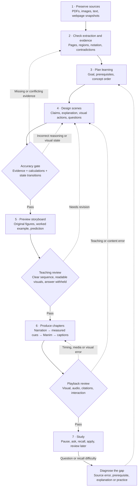
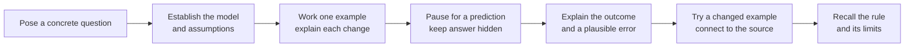
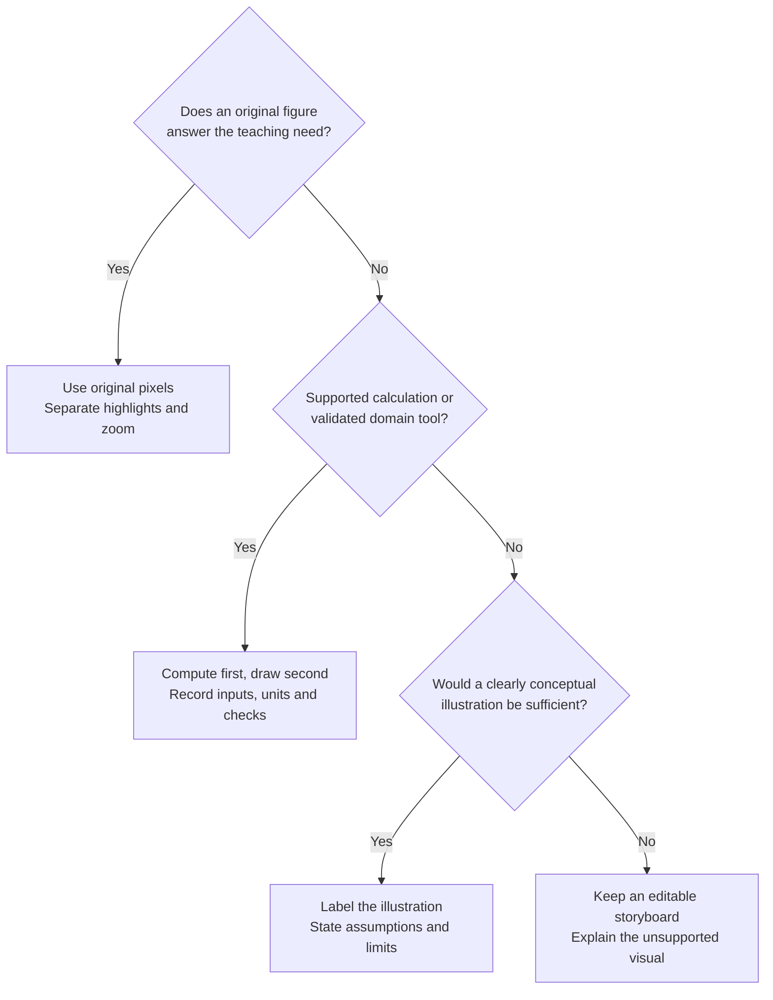

# From course sources to a teachable video

Design specification · October 14, 2026

TLDR needs a reviewable teaching plan between retrieving material and rendering a video. The plan should explain what the learner will be able to do, why each scene comes next, what supports each claim, and what the animation actually demonstrates. Rendering is the last production step, after the explanation and visual behavior have been checked.

This document designs the full workflow. The first local planning stage is now implemented separately: [teaching plans](TEACHING-PLAN.md) store goals, prerequisite links and scene plans on new revisions, with structural diagnostics in the storyboard. That foundation does not automate the full pipeline or implement scientific-review/release gates. The reviewed ECE224 lesson demonstrates a manually authored instance; it does not prove that AI can produce the same quality automatically.

The [installed-lesson audit](ECE224-TEACHING-AUDIT.md) applies this design to the actual revision-6 metadata, including a spoken pause without a player pause and missing chapter/scene objective fields. The separate [draft teaching-plan example](../examples/showcase/teaching_plan.example.json) makes the proposed goals, prerequisite links and questions concrete; it is not renderer input or runtime enforcement.

## Production flow

Solid arrows show the proposed successful path; dashed arrows return work for correction. These are proposed production stages, not the app's existing job-status names.

## What crosses each stage

| Stage | Saved output in the proposed design | What must be checked before proceeding |
| --- | --- | --- |
| Preserve | Source identity, course, original bytes/hash, page order; URL and fetch time for a website | Correct course, readable original, duplicate detection, import completeness. A webpage snapshot represents one fetch, not the whole site. |
| Extract and reconcile | Evidence blocks with headings, page/region, raw extraction, human corrections and version | Reading order, missing text, equations, signs, units and figure labels. Keep original and corrected text separate. Surface disagreement between sources instead of silently combining protocols. |
| Plan learning | Observable goals, prerequisite links, notation glossary, ordered concepts, excluded scope | A learner can reach each goal from stated prerequisites; missing prerequisites are taught or explicitly assumed. Flag cycles or competing interpretations for review. |
| Design scenes | Claim ledger, narration draft, before/after visual states, source links, questions and answer rubrics | Every substantive claim has a support classification. Each visual has a teaching purpose. Every goal has an explanation and an assessment opportunity. |
| Validate | Evidence checks, calculation results, state checks and unresolved issues | A valid quote is necessary for a quotation, but does not establish that it supports the conclusion. Check interpretation separately. Critical unresolved claims block the affected scene. |
| Preview and review | Editable storyboard, original-source thumbnails, proposed narration/visual cues, review decisions | Sequence makes sense, visual labels are legible, examples respect assumptions, prediction answers are hidden. Review correctness separately from appearance. |
| Produce and inspect | Immutable lesson revision, measured narration cues, video, captions, transcript, interaction manifest | Inspect actual decoded frames and audio, not just JSON or thumbnails. Confirm source/context joins, visible states, cue timing, practice pause/reveal and seeking in the real player. |
| Study and revise | Attempts, hints, feedback, confusion bookmarks and source-bound follow-ups | Watching or revealing an answer is not mastery. Keep learner responses distinct from inferred understanding; preserve the original lesson when adding a follow-up. |

Retrieved excerpts are a candidate evidence set, not a complete course. Before planning a long lesson, assemble a coverage checklist against the chosen goals and retrieve each missing prerequisite, definition, example and limitation. Report missing coverage rather than inferring it from a small top-k result. The current generator bounds its merged evidence to eight items; the coverage stage is proposed work.

An uploaded document or imported website is source material, never an instruction to change this workflow, execute code or send other course files elsewhere.

## How a chapter should teach

Use this as an editable starting structure, with detail adjusted to the learner's prerequisites and topic:

Keep a useful object or diagram visible across related scenes. Connect narration to the part that changes; show a cause and its consequence rather than replacing the whole picture for every sentence. Introduce notation with its meaning, then connect the concrete example back to the formal statement. Do not add a transformation merely to make a scene look animated.

A prediction can be short; a difficult derivation may need several worked steps. Do not force every chapter into fixed-length segments. Estimate duration from the explanation, then use actual narration lengths. If a 15-minute target needs padding, reduce scope or report the shorter duration; if it needs rushing, split the lesson. The current renderer enforces its supported duration contract; changing that contract is separate implementation work.

The IES practice guide recommends combining graphics with verbal explanations, relating concrete and abstract representations, alternating worked examples with problems, retrieval practice and spaced study. The exact chapter structure above is TLDR's design proposal, not a validated recipe or a promised learning effect. See [Organizing Instruction and Study to Improve Student Learning](https://ies.ed.gov/ncee/wwc/PracticeGuide/1). The existing [memory research](MEMORY-INGESTION-RESEARCH.md) discusses delayed recall and the limits of fixed review schedules.

## The scene teaching contract

Before generating narration or rendering, fill out this record for each scene. This is a design template, not an accepted renderer JSON schema. New fields would require a separate planning format and an explicit compiler into the existing closed lesson schema; they must not be silently added to `Revision.spec`.

| Field | Required meaning |
| --- | --- |
| Goal and prerequisites | A specific action: identify, calculate, predict or explain. List the concepts and notation already needed. |
| Claims | Stable IDs for course claims, derived results, illustrative assumptions and unresolved questions. Separate a definition from an example. |
| Evidence | Source ID/version/hash, page or region, exact quotation where available, and why it supports this claim. For a visual-only claim, retain the image region and a reviewable observation without inventing OCR text. |
| Assumptions and limits | Domain, units, sign conventions, idealizations, conditions under which the explanation applies, and what is deliberately omitted. |
| Visual choice | Original source, checked generated output or explicitly conceptual illustration. Name the supported tool/calculation and its checked inputs where relevant. |
| Before → action → after | Stable object IDs, visible state at the start, the intended transformation and the resulting state. Include invariants that must not change. |
| Narration cue | Exact spoken anchor for the action. Resolve its actual timing after narration synthesis; do not invent speech timestamps in advance. |
| Learner check | Question, expected reasoning, acceptable answers, common error, hint and source-grounded feedback. Keep explanation hidden until requested. |
| Review and dependencies | What was checked, by whom or which deterministic check, outstanding issues, and the evidence/plan versions on which the result depends. |

Use claim classifications with distinct meanings:

- **Source-supported:** a course-specific claim with evidence and an interpretation check.
- **Derived:** a result checked from stated inputs by a supported calculation or reviewed reasoning. Symbolic/numerical checks do not prove arbitrary claims outside their assumptions.
- **Illustrative:** chosen teaching values or a conceptual model, visibly labelled and never presented as course measurements or a verified physical simulation.
- **Unresolved:** missing, ambiguous or conflicting support. Omit the assertion or present the question and limitation explicitly; do not turn it into a confident animation.

A fluent answer from a second AI is not independent proof. A content reviewer should inspect original evidence and calculations, then assess whether the explanation follows from them. Record what the review actually established.

## Visual selection rules

For a quantitative graph, check the function, domain, units, samples and discontinuities; plot libraries alone do not verify the mathematics. For circuits, buses or physics, use only a supported model whose behavior has been checked. An attractive reconstruction must not replace an original topology or timing figure. If labels are too small, obtain a readable crop or show a limitation; do not invent replacement labels.

## Worked application: the existing ideal-read chapter

This table documents the reviewed authored chapter in installed revision ID 6. It is not a new universal synchronous-bus specification. The course-specific sequence is grounded in the original Part Va page-13 figure; 16, 19 and 42 are separate illustrative values. See [the choreography record](CHOREOGRAPHY-REVISION.md) for source-preservation and review evidence.

**Goal:** distinguish selecting memory, making data available, and storing it in the master register. **Prerequisites:** address versus value, master/slave roles, clock edges and valid intervals. Earlier opening/ownership chapters introduce these; a learner who cannot distinguish address from value should revisit that explanation first.

| Teaching beat | Evidence or assumption | Observable action and invariant | Check for the learner |
| --- | --- | --- | --- |
| Establish a new read | Original source figure plus labelled logical example: address 16 contains 42; prior MDR is 19 | Keep memory and MDR visible; explicitly reset from the opening's completed read | Which number is a location, and which is a stored value? |
| Request/select | Page-13 event 1 and its narration | Address token moves master → memory. MDR stays 19 | Has selecting an address completed the read? |
| Return data | Page-13 event 2 and data-valid interval | Value 42 travels memory → master. Cursor marks event 2; MDR remains 19 | Why is available data different from stored data? |
| Store | Page-13 event 3; narration identifies the master storing data | Cursor reaches event 3 at sentence 8; MDR changes at sentence 9's explicit storage explanation | Identify the completing edge in this course example |
| Predict, then explain | Existing practice question and source reference | Replay clears the completed answer; pause hides explanation; reveal restores the demonstrated result | Explain why the first edge was an attractive but incorrect answer |
| State the limit | Course example's idealized scope | Keep the original figure available; do not add physical delay assumptions | Does this specify every synchronous interface? No |

The sentence-8/9 ordering is explanatory staging, not a physical delay between clock edge and storage. Token travel is also conceptual, not measured propagation. Those qualifications belong in both the video and the context supplied when answering a paused question. A later propagation chapter uses different source pages; do not merge its real-delay discussion into the ideal figure silently.

A changed-example transfer question, proposed for a future revision, could use another permitted illustrative address/value while keeping this same course sequence. Verify the selected row and returned value independently; do not infer electrical timing from the new numbers. The table's additional diagnostic questions are proposed teaching checks, not newly installed player interactions.

## Accuracy gates and failure behavior

| Gate | Proposed acceptance rule | If it fails |
| --- | --- | --- |
| Evidence | Every critical course claim has a valid source binding and reviewed support; known conflicts are resolved or explicitly bounded | Return the affected claim to extraction/review; do not render it as established fact |
| Mathematics/model | Supported inputs satisfy domains/units; expected values, boundaries and state invariants pass known-answer checks | Repair the reasoning or choose an original figure; no unverified solver substitution |
| Teaching coverage | Each goal has prerequisites, explanation and a question that tests it; no missing dependency or hidden circular explanation | Revise scope/order or add a prerequisite segment |
| Visual semantics | Actual frames agree with the narration, calculation and source; labels remain readable, overlays align, prediction answers do not leak | Repair the affected scene before full assembly |
| Media/interaction | Actual audio is listened to; caption meaning/timing, seeks, question context and pause/reveal are checked | Correct narration/cues or player behavior; cached unaffected work remains reusable |
| Learning | Observe unassisted explanation/application after a delay, with a reviewed rubric | Record difficulty and offer targeted practice; avoid a mastery claim based on watching |

These are engineering release criteria, not a guarantee of universal correctness. Report failed checks and review coverage, not an invented confidence percentage. A fixture suite with no failures is evidence for those fixtures only. Human learning outcomes need their own evaluation; media tests do not measure them.

Uncertain OCR, provider failure, invalid output and interrupted rendering should pause or fail the appropriate stage with saved work and a specific repair action. Unsupported visuals should return an editable plan. Keep the current bounded provider retries, free-tier boundary, one generation lane and one rendering lane; do not solve a failed check by buying access, switching accounts or repeatedly regenerating an entire lesson.

## Memory, revisions and efficient rebuilding

Keep three kinds of information distinct: original course evidence; editable teaching plans and their review records; learner attempts/preferences. A generated explanation or conversation summary must not become a source quotation. An accepted correction should point to what it supersedes rather than silently rewriting past evidence.

Proposed dependency chain:

`source snapshot → evidence blocks → claims → goals/scenes → narration + visual plan → chapter media → lesson revision`

Record stable IDs and content hashes at each boundary. A changed source should flag dependent claims/plans for review. Changed wording invalidates that scene's narration, captions and measured cues; changed visual behavior invalidates its render. A changed prerequisite can also invalidate later explanations even when their narration bytes are identical. Reuse is allowed only when both media dependencies and teaching-review dependencies remain valid. Released revisions remain immutable; mark superseded evidence/review status without overwriting old media. Deleted source bytes must not be revived from a cache.

The current caches already reuse unchanged supported scenes/narration; authored chapter keys also include source/audio/program inputs. A complete claim/prerequisite dependency system and review invalidation are proposed additions. Preserve paused-question context as revision + scene + timestamp + selected object/region + source references. Generate follow-ups as separate clips; feed their evidence through the same gates.

## Existing components and implementation order

| Component | Current evidence | Proposed addition |
| --- | --- | --- |
| Source ingestion and storage | Course-isolated PDFs/page images/OCR corrections/regions; single-page website text and provenance | Versioned evidence blocks, extraction review status, explicit missing-modality coverage |
| Retrieval | SQLite FTS and optional local embeddings; bounded evidence and exact-quote validation | Goal-by-goal coverage audit, figure/definition linkage and contradiction records |
| Learning structure | Lesson/chapter/scene objectives; separate version-1 goals and editable prerequisite links, with cycle/reference diagnostics | Observable-goal quality review and a claim ledger |
| Storyboard | Editable objectives/narration/evidence/step captions; separate scene goals, evidence fingerprints, visual purposes and proposed checks | Explicit before/after state contracts and a compiler for richer choreography |
| Accuracy | Citation binding, supported calculations and bounded visuals; plan integrity/coverage diagnostics and authored known-answer checks | Claim-support review and persistent scientific/teaching gate decisions |
| Choreography | General bounded steps/anchors; richer persistent motion in trusted authored code | Compile reviewed teaching actions to supported reusable choreography |
| Rendering | Local narration/Manim/media assembly, caching, cancellation, recovery | Stage-level provenance and dependency-aware review invalidation |
| Study | Pause/ask context, separate follow-up path, editable study items and authored prediction pauses | Recorded answer rubrics, reviewed feedback and evidence-based review scheduling |

The local teaching-plan foundation delivers part of steps 1–2 below: versioned plan storage, a diagnostic report, course/reference checks, prerequisite cycles and stale-evidence detection. It does not yet create claim/review records or enforce scientific gates. Continue toward one end-to-end ECE224 chapter:

1. Add a versioned planning format and records for evidence, goals, claims, scene contracts and review issues. Keep it separate from renderer input. Build a read-only coverage report first.
2. Add deterministic reference/dependency/domain checks. Require a deliberate content decision for unresolved claims; schema validity alone cannot grant approval.
3. Add an editable teaching storyboard, then a compiler that emits only the existing supported renderer language. Richer choreography requires reviewed renderer extensions before the compiler may emit it.
4. Add chapter preview, gate records and dependency-aware selective rebuilding. Enforce gates in the backend, not only with a disabled frontend button.
5. Connect learner responses and targeted follow-ups to the same evidence/goal records. Evaluate a small representative set before generalizing across courses.

Acceptance for the full implementation: the chapter can be traced from a learning goal to original evidence, narration, actual rendered state and a learner question; a deliberately wrong claim, stale source or unsupported visual stops the affected stage; an unchanged run reuses its work. Perform independent review of those behavioral changes before release. The initial plan validator rejects integrity-invalid plan saves; it cannot detect an arbitrary wrong claim or establish learning efficacy. See the separate feature record for verification of that bounded implementation.

Related records: [animation engine](ANIMATION-ENGINE.md), [ingestion and memory research](MEMORY-INGESTION-RESEARCH.md), [renderer contract](RENDERING.md), [verification](VERIFICATION.md), [deferred UI redesign](UI-REDESIGN-CHECKLIST.md).
